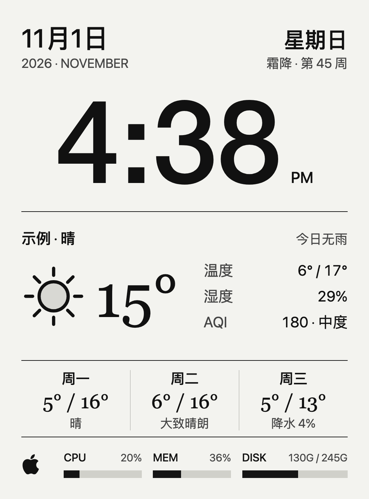

# Kindle Dashboard

[](https://github.com/Pengyang233/kindle-dashboard/releases/latest)
[](https://github.com/Pengyang233/kindle-dashboard/actions/workflows/ci.yml)
[](LICENSE)

这是一个给越狱 Kindle 用的小看板：Mac mini 获取天气、读取本机状态并生成黑白 PNG；Kindle 通过 Wi-Fi 下载图片，再由 FBInk 显示。Kindle 端不运行浏览器，启动由 KUAL 手动控制。本项目不会替你越狱 Kindle。



*上图是内置测试画面，使用固定示例数据。*

## 当前版本

[v1.0.6](https://github.com/Pengyang233/kindle-dashboard/releases/tag/v1.0.6) 已在 Kindle Paperwhite 4、固件 5.18.1.1.1、KUAL 和 FBInk 组合上完成实机验证。其他 Kindle 型号和固件尚未验证；完整范围见[发布状态说明](docs/release-status.md)。

当前工作区新增时钟模板：大号 12 小时制时分、节日优先的节气栏、天气与三日文字预报，以及 Mac 的 CPU、内存和磁盘状态。旧版无时钟模板完整保留，可设置 `DASHBOARD_LAYOUT=weather` 恢复。时钟模板每分钟对齐整分取图；每 12 次成功显示额外完全清屏一次，约 12 分钟。完整设置和恢复方法见[时钟与刷新说明](docs/clock-refresh.md)。

天气每 15 分钟在后台更新；国标 AQI 使用中国环境监测总站的城市实时发布数据，避免将美标数值直接套用国标等级。网络或渲染失败仍会保留上一张有效画面。当前客户端工作版本为 1.0.7，尚未发布为新的 GitHub Release。

## 需要准备什么

- 一台安装了 Node.js 22.13+ 和 Google Chrome 的 Mac。
- 一台装有 KUAL 和 FBInk 的越狱 Kindle。当前只在 Kindle Paperwhite 4、固件 5.18.1.1.1 上验证过。
- Kindle 和 Mac 通过可信的家庭局域网通信。

如果还在准备 Kindle，请先看[设备准备与首次运行](docs/first-run.md)。越狱方法取决于具体机型和固件；本项目不会替你越狱。

## 启动 Mac 服务

```sh
git clone https://github.com/Pengyang233/kindle-dashboard.git
cd kindle-dashboard
npm ci
npm run setup-local
```

编辑 `.env.local`，填写天气坐标，也可以修改城市名和时区。天气坐标会发送给 [Open-Meteo](https://open-meteo.com/en/docs) 以获取预报。

服务默认只监听 Mac 本机。如果 Kindle 要从局域网访问，在 `.env.local` 中将 `HOST` 设为 `0.0.0.0`，并将 `DASHBOARD_CONTROL_ORIGINS` 设为浏览器访问控制页时使用的完整来源，例如 `http://192.0.2.10:8787`。这个 IP 只是文档示例，请换成 Mac 的实际局域网地址。

然后暂存客户端并启动服务：

```sh
npm run stage-client-release
npm start
```

本机预览：

- 画面：<http://127.0.0.1:8787/render>
- 控制页：<http://127.0.0.1:8787/control>（需要 `.env.local` 中的 HTTP Basic 凭据）

需要在 Mac 登录后自动运行时，可以安装 launchd 服务：

```sh
./scripts/install-macos-service.sh
```

卸载服务：

```sh
./scripts/uninstall-macos-service.sh
```

`npm run setup-local` 会在 `.env.local` 中生成设备令牌和管理员密码，不会把它们打印到终端。这个文件只留在本机，不要提交或打包。

### 常用配置

| 配置 | 用途 | 默认值 |
| --- | --- | --- |
| `DASHBOARD_CITY`、`DASHBOARD_TIMEZONE` | 画面显示的城市名和时区 | `Example`、`Asia/Shanghai` |
| `DASHBOARD_LAYOUT` | `clock` 时钟模板，或 `weather` 恢复旧版 | `clock` |
| `AIR_QUALITY_CITY` | 中国环境监测总站城市名 | 沿用 `DASHBOARD_CITY` |
| `WEATHER_LATITUDE`、`WEATHER_LONGITUDE` | 天气查询位置 | 空，需填写 |
| `HOST`、`PORT` | 服务监听地址和端口 | `127.0.0.1`、`8787` |
| `DASHBOARD_DEVICE_ID` | Kindle 设备标识 | `pw4` |
| `DASHBOARD_DEVICE_TOKEN` | Kindle 请求服务的令牌 | 初始化时生成 |
| `DASHBOARD_ADMIN_USER`、`DASHBOARD_ADMIN_PASSWORD` | 控制页登录凭据 | `admin`、初始化时生成 |
| `DASHBOARD_CONTROL_ORIGINS` | 控制页允许发起操作的浏览器来源 | 本机地址和 `localhost` |

完整配置名见 [`.env.example`](.env.example)。客户端快照目录由 `npm run stage-client-release` 写入本地配置。

## 安装到 Kindle

首次部署按[设备准备与首次运行](docs/first-run.md)走一遍：确认 Kindle 运行条件、复制客户端、检查离线显示、配置 Mac 服务并验证设备连接。首次安装需要 USB；完成后，取图通过 Wi-Fi 进行。

如果只想单独检查 KUAL 是否能调用 FBInk 显示图片，请看[离线显示检查说明](kindle/SMOKE-TEST.md)。

## 更新方式

KUAL 启动保持手动，不会开机自动运行。服务从 `CLIENT_DISTRIBUTION_DIR` 指向的固定快照提供客户端文件，不会直接分发工作区里的改动。更新客户端时，修改远程分发文件后提高 `kindle/kindle-dashboard/VERSION` 和 `config.xml` 中的版本号，再运行 `npm run stage-client-release`。暂存不会联系 Kindle；重启服务后才会选用新的快照。

客户端更新器只处理列入清单的 17 个文件，设备私有的 `config.sh` 不在清单内。SHA-256 和文件大小检查可以发现传输损坏，但不能证明文件发布者身份。

## 安全与隐私

服务使用没有 TLS 的 HTTP，只应运行在可信的局域网内。不要把 8787 端口转发到公网。控制页密码和设备令牌会经过这条连接，能监听或篡改局域网流量的人可能读取凭据或替换响应。

真实配置、设备 `config.sh` 和运行日志不要提交到 GitHub。第三方组件和图标许可见 [`THIRD_PARTY_NOTICES.md`](THIRD_PARTY_NOTICES.md)；更完整的网络边界见 [安全模型](docs/security-model.md)。发现安全问题时请先阅读 [`SECURITY.md`](SECURITY.md)。

## 开发与反馈

```sh
npm test
npm run check:public
sh scripts/build-kindle-package.sh
```

GitHub Actions 还会检查 Shell 和 JSON、构建客户端包并扫描公开内容。CI 运行在 Ubuntu 上；它验证源码和打包流程，不代表服务器已在 Linux 上验证，也不代表其他 Kindle 型号或固件兼容。

提交问题时，请写明 Kindle 型号和固件、macOS 与 Node.js 版本，以及复现步骤。分享日志前先删掉令牌、密码、精确坐标和其他私人信息。欢迎提交文档改进和修复。

---

- [Release 下载](https://github.com/Pengyang233/kindle-dashboard/releases)
- [第三方许可](THIRD_PARTY_NOTICES.md)
- [MIT License](LICENSE)
